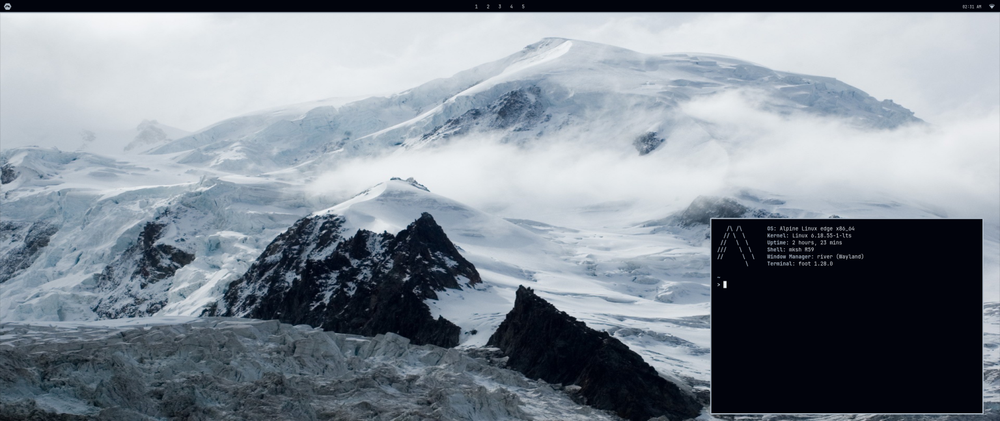

## Minimalistic rice
  
 - This is my minimalistic rice, it uses [waybar](https://github.com/Alexays/Waybar) for its bar, [River-classic](https://codeberg.org/unixchad/river-classic) for the Window manager, [fuzzel](https://codeberg.org/dnkl/fuzzel)as launcher and [foot](https://codeberg.org/dnkl/foot) for the terminal

### This is how it should look like: 

